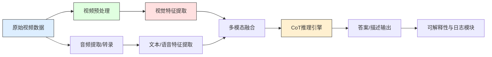
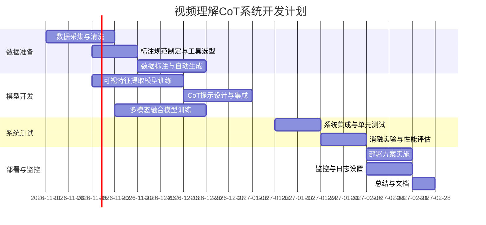

# 执行摘要

本报告提出了一套基于“链式思维”（Chain-of-Thought, CoT）的多模态视频理解系统实施方案，覆盖从目标定义、架构设计、数据采集标注、模型设计与训练到评估与部署的各个阶段。首先，我们明确了常见的学术和工程用例，例如视频问答(VideoQA)、视频描述(Video Captioning)、行为识别等，并为每种任务列出了关键评估指标（如准确率、BLEU、延迟、资源消耗等）和适用场景。系统总体架构采用模块化设计，包括数据采集与标注、视频预处理与特征提取、CoT推理、多模态融合、训练与微调、评估、部署与监控，以及可解释性和日志等模块。每个模块都给出了功能说明、输入输出格式、推荐技术栈以及接口示例。例如，**数据标注**模块可使用CVAT等工具生成JSON格式的标注文件；**视频预处理**模块调用PyTorch的`torchvision.io.VideoReader`逐帧读取视频；**CoT推理**模块通过调用大型语言模型（如GPT-4、LLaMA等）生成逐步推理过程。我们还给出了常用数据集的比较表格（如MSVD、MSR-VTT、TGIF-QA等）和对应的适用场景。模型设计部分详细讨论了如何在时序级别引入CoT，例如帧级或片段级的提示设计，以及候选架构（视觉骨干网、时序模型、语言模型）、损失函数和训练策略等。实验评估部分列出了基线设置、消融实验、可复现的训练验证流程，以及性能优化方法（模型量化、蒸馏、加速推理）。报告还包括部署方案：在线/离线服务架构、资源估算、容器化与CI/CD建议、监控与故障排查清单。最后，我们给出了按周划分的开发计划（包含甘特图/时间线）、关键里程碑，以及主要风险及其替代方案。报告引用了相关权威论文、官方文档和数据集网站等资料。

## 1. 目标与用例场景

本项目目标是在已有视频理解基础上，引入链式思维推理能力，构建一个从视频到答案的多模态理解系统。常见的目标用例包括：  
- **视频问答（VideoQA）**：回答关于视频内容的问题，适用于智能助理、监控分析等场景。评价指标包括回答准确率、回答生成的BLEU/METEOR分数等。  
- **视频描述/摘要（Video Captioning/Summarization）**：生成自然语言描述视频内容或摘要，适用于视频检索、内容推荐等。评估指标常用BLEU、ROUGE或CIDEr。  
- **行为识别（Action Recognition）**：识别视频中的动作类别，适用于自动监控、体育动作分析。指标包括Top-1/Top-5准确率、F1等。  
- **跨模态检索（Video Retrieval）**：根据文本检索视频，或根据视频检索文本，指标为检索准确率（mAP）。  
- **知识提取/因果推理**：对视频中的因果关系和事件序列进行推理与解释，指标可包括推理正确率或用户满意度等。  
- **对话/智能助理**：基于视频内容进行对话或指令执行，评估指标为问答准确率或任务完成率。  

链式思维方法特别适合需要多步推理的场景，如复杂事件分析或因果推断。研究表明，在大型语言模型中引入CoT提示能够显著提升多步推理能力。因此，我们的系统将通过CoT技术增强视频理解模型的推理能力，如逐帧分析、场景推理等。

**评估指标**：对于不同用例，我们建议同时考虑传统准确率（accuracy）、生成任务的BLEU/METEOR等文本质量指标，以及系统指标如**延迟**（单次推理/每帧处理时间）和**资源消耗**（GPU/CPU利用率、内存占用）。例如，视频问答任务常用Top-1准确率和回答BLEU分数；视频分类任务关注准确率和F1；系统级评估还需监控实时延迟（ms）和吞吐量。资源消耗方面，应统计模型参数量、推理时GPU显存、CPU线程数等，以便后续部署评估。

## 2. 系统总体架构与模块划分

系统采用典型的视频-文本多模态处理流水线，分为以下模块（图示流程见下方）。整体信息流从原始视频数据开始，经过预处理和特征提取，进入链式思维推理模块和多模态融合，最终生成输出并用于训练/推理。各模块如下：  



1. **数据采集与标注**：负责收集原始视频及相关标签。输入为各种来源的视频文件（如YouTube、公开数据集、监控摄像头等），输出为结构化标注数据。可使用爬虫接口（如YouTube API、影视字幕库）获取视频源，结合自动化方法（OCR、ASR识别字幕/语音）和人工标注工具（CVAT、LabelStudio）生成问答对、摘要或分类标签。输出格式可采用JSON。例如，一个视频QA样本的标注格式可能为：  
   ```json
   {
     "video_id": "video123",
     "captions": ["A man plays guitar.", "He is performing on stage."],
     "QA": [
       {"question": "What instrument is the man playing?", "answer": "Guitar"},
       {"question": "Where is he performing?", "answer": "On stage"}
     ]
   }
   ```  
   **技术栈**：可以使用Python爬虫、YouTube Data API、Selenium等采集视频信息。标注方面推荐使用CVAT（支持视频时序标注）或Label Studio（开源多模态标注平台）。若需要生成大量QA对，可参考Yang等方法，使用预训练的问答生成模型自动从视频转录中生成。在数据阶段需要注意隐私合规，例如遵循GDPR、CCPA规定，对敏感内容进行脱敏处理（模糊人脸、去除水印等）。

2. **视频预处理与特征提取**：输入为原始视频文件，输出为可供模型处理的视觉/音频特征。主要任务包括：  
   - **视频解码与帧抽取**：将视频拆分为连续帧。可以使用OpenCV或PyTorch的`VideoReader`接口高效读取视频。例：  
     ```python
     import torchvision, itertools
     reader = torchvision.io.VideoReader("data/video.mp4", "video")  # TorchVision视频读取
     reader.seek(2.0)  # 跳到2秒处
     frame = next(reader)['data']  # 获取一帧图像
     ```。  
   - **图像预处理**：对帧进行裁剪、缩放、归一化等操作。可以采用PyTorch/TensorFlow的数据变换（如`torchvision.transforms`）。  
   - **视觉特征提取**：将帧图像输入视觉骨干网络提取特征向量。例如使用2D CNN（ResNet、EfficientNet）或3D CNN（I3D、SlowFast）逐帧/逐片段提取空间特征，或使用视觉Transformer（TimeSformer、ViViT）处理帧序列。输出可为每帧或每段的特征张量。推荐技术栈包括PyTorch、TensorFlow以及预训练模型库（TorchVision、TorchVideo、MMAction2、ModelScope等）。  
   - **音频/文本特征**：从视频的音轨提取语音转文本（ASR），或直接使用音频特征（MFCC、Wav2Vec2.0等）。文本可通过预训练语言模型（BERT、GPT）编码得到特征向量。若视频自带字幕，可直接使用OCR提取文本。输出可为文本字符串或其Embedding向量。  
   **接口示例**：设输入为`video_frames: Tensor[T,H,W,C]`，输出为`video_feats: Tensor[T,F]`，`audio_feats: Tensor[K]`等。

3. **CoT推理模块**：核心推理引擎，将多模态输入转化为答案或描述，并附带中间推理步骤（“链式思维”）。输入可包含视觉特征序列和任务提示（如问题或指令）。输出是包含推理步骤和最终回答的文本。实现方式之一是使用大型语言模型（LLM）进行提示式生成：先构造系统/用户提示（prompt），让模型“逐步解释”视频内容。例如，利用ChatGPT/GPT-4 API或开源LLaMA-2模型，通过加入指令“请一步步描述视频中的场景”，引导模型生成分步推理。示例代码：  
   ```python
   from transformers import AutoModelForCausalLM, AutoTokenizer
   tokenizer = AutoTokenizer.from_pretrained("gpt-4")
   model = AutoModelForCausalLM.from_pretrained("gpt-4")
   prompt = "视频帧信息：[...]。请详细说明视频内容的推理步骤，然后给出答案。"
   inputs = tokenizer(prompt, return_tensors="pt")
   outputs = model.generate(**inputs)
   result = tokenizer.decode(outputs[0])
   ```  
   该模块可基于OpenAI API调用ChatCompletion（例如GPT-4）或本地部署的LLM（如LLaMA、Baichuan、鹰飞等）。技术栈包括Hugging Face Transformers或LangChain等。**注意**：CoT推理可能耗费较多计算资源且存在“幻觉”风险，需要在后续设计中加入校验机制（如检索验证）和日志记录。  
   大型模型链式思维提示可在复杂推理任务中显著提高性能。

4. **多模态融合**：将视觉、音频和文本特征融合为统一表示。典型方法包括简单拼接、注意力机制或使用跨模态Transformer。可采用类似CLIP的对比学习策略，使视觉和文本向量位于同一空间。也可使用多模态模型如ViLT、UNITER、BLIP系列等，对齐图像与文本信息。接口示例：一个简单的API可能接收`video_feats`和`text_feats`，输出融合后的向量`fused_feats`。推荐技术：PyTorch中的多模态库（MMF、VL-BERT等）、Cross-Attention模块、Hugging Face的VisionEncoderDecoder模型等。  

5. **训练与微调**：在融合特征基础上训练最终模型。根据任务选择合适损失：分类任务用交叉熵，生成任务用交叉熵或混合损失（例如答案生成+排序损失），对比学习用InfoNCE等。训练策略可采用“预训练→微调”范式：先在大规模视频+文本数据上自监督预训练（如VideoBERT、VideoCLIP），再在目标任务数据上微调。可以采用多任务学习，如同时训练视频描述和QA，以共享特征。框架建议PyTorch Lightning或TensorFlow+Keras，结合Hugging Face Trainer。示例伪代码：  
   ```python
   for epoch in range(EPOCH):
       for batch in dataloader:
           video_feats, text_inputs, labels = batch
           logits = model(video_feats, text_inputs)
           loss = loss_fn(logits, labels)
           loss.backward()
           optimizer.step()
   ```  
   **超参数建议**：根据数据规模给出小/中/大规模配置。未指定情况下，可考虑学习率1e-4、批量大小16~32（受显存限制），使用AdamW优化。若模型很大，应用梯度累积、多机分布式等。

6. **评估与监控**：训练过程要设置验证集监控性能指标，如验证准确率、BLEU、损失曲线等，保证可复现。离线评估时进行消融实验：对比有无CoT、不同模态输入、不同特征融合方式的效果。构建实验矩阵表，如下所示（示例）：  

| 实验配置           | CoT使用 | 模态输入       | 数据集       | 主要指标           | 预期结果                |
|------------------|--------|-------------|------------|----------------|--------------------|
| 基线模型         | 否     | 视频        | MSR-VTT   | BLEU/METEOR     | 参照文献水平            |
| 加入CoT         | 是     | 视频+文本    | MSR-VTT   | BLEU/METEOR↑    | 期望提升2~5%（）|
| 去掉音频        | 是     | 视频+文本    | HowToQA   | QA准确率↓       | 音频丢失可能降低问答准确率  |
| 不同骨干网络     | 是     | 视频+音频    | MSVD       | BLEU差异        | 深层网络比浅层表现好     |
| 量化/蒸馏后推理   | 是     | 视频+文本    | MSR-VTT   | 推理延迟↓       | 精度略有下降            |

在评估中，需要记录详细配置和随机种子，以保证可复现。对于推理性能优化，可尝试模型量化、蒸馏到小模型、使用TensorRT或ONNX加速等。

7. **部署与监控**：针对线上服务需求，设计推理服务架构。可选择在线推理（RESTful API或gRPC）或离线批处理模式。估算资源：例如**小规模**原型可使用单台8核CPU、1张NVIDIA T4 GPU；**中规模**可用4核CPU+1张A100；**大规模**部署或高并发时采用分布式集群。推荐使用Docker容器化部署，结合Kubernetes进行弹性伸缩。CI/CD可通过GitHub Actions或Jenkins实现自动化构建和测试。监控方面，引入Prometheus/Grafana监控延迟、吞吐量、异常日志等。日志收集方面可使用ELK Stack记录模型输入输出和推理过程，便于追踪问题。

常见故障排查包括：内存不足（降低BatchSize或模型规模）、推理延迟过高（分析瓶颈，使用异步调用或推理加速）、模型精度不达标（检查数据偏差、重新标注）等。

8. **可解释性与日志**：链式思维输出本身具有一定的可解释性，但仍需辅助模块记录中间特征和模型决策。可以记录视觉特征热图、注意力权重分布等。日志中应详细记录每次推理的输入（或其摘要）、输出步骤与结果，以便后续人工审核和性能分析。例如，可将CoT每一步生成的文本保存在结构化日志中。

## 3. 数据需求与标注规范

系统所需数据包括视频及相应文本标注（描述、问答对、分类标签等）。对于大规模预训练，可利用公开数据集或网课/教学视频（如HowTo100M）。对于特定任务，需要专业标注。下面给出数据需求与常用数据集比较：

- **数据量估算**：预研阶段可从几百小时的视频起步，结合自动标注扩展规模（例如 HowToVQA69M 生成了69M个QA对）。**小规模**实验可用几十小时视频，**中规模**上百小时，**大规模**可上千小时，并辅以自动生成方法。
- **采集来源**：YouTube、教学视频、监控摄像头、现有数据集等。注意版权和隐私：需删除人脸、水印，确保数据符合使用许可。
- **标注工具与规范**：使用CVAT、Label Studio等，可支持视频逐帧/段标注。**标注指南**示例：对于问答任务，要求标注者针对视频场景提出开放或选择题，并给出准确答案；对于描述任务，要求简洁客观地描述关键事件。工具可输出JSON或COCO格式的标注文件，每条记录包含`video_id`、`timestamp`、`question/answer`或`caption`字段等。
- **数据增强策略**：对视频进行多模态增强，如随机裁剪、旋转、颜色抖动等；时序方面可随机采样片段；语音可加噪声。针对对比学习，可使用视频反演、时序扰动增强模型鲁棒性。
- **常用数据集比较**：下表列举了一些典型公开数据集及其适用场景。

| 数据集        | 任务类型     | 数据规模/特点                         | 适用场景            |
|------------|----------|-----------------------------------|------------------|
| MSVD | 视频描述 (Caption) | ~1,970 视频 (训练1,200)；共~80K英文字幕  | 短视频描述，多场景 |
| MSR-VTT | 视频描述/检索 | 10,000 视频，20类别，每视频20个字幕  | 多场景视频描述/检索 |
| TGIF-QA  | 视频问答       | 165K QA对（GIF集），涉及动作和因果 | 动作理解QA       |
| HowToVQA69M | 视频问答       | 约70K视频（HowTo100M子集），自动生成69M QA  | 教学视频问答       |
| ActivityNet Captions | 时间定位与描述   | ~20K长视频，带有时间段级描述           | 视频分段描述、事件检索 |
| Kinetics-400  | 动作分类       | 400类，30万视频剪辑                 | 通用动作识别       |
| DiDeMo       | 事件定位与描述   | 10K视频，27K事件瞬间标注      | 视频时序事件定位    |

上述数据集仅作为示例，实际项目可根据任务选择合适的数据。如果需要构建新的数据集，应明确标注细则并进行多轮审校，保证高质量标注。此外注意数据隐私和合规性，避免使用受版权约束的视频。

## 4. 模型设计细节

**CoT与时序建模**：我们拟采用Transformer或LSTM等模型对视频时序建模，同时在输入中融入链式提示。例如，可将连续帧或视频片段特征作为一系列“句子”，让语言模型在回答问题时生成每个片段的推理步骤（帧/片段级CoT）。跨模态提示设计方面，常见做法是将视觉特征映射为初始提示词（prompt），然后让LLM输出解释；或使用可学习的Query-Former从视频中提取关键提示，再送入LLM。

**候选模型架构**：  
- **视觉骨干**：ResNet、EfficientNet、ViT（如CLIP的ViT-B/16）、Swin Transformer、时序模型（3D-ResNet、SlowFast、TimeSformer）等，用于提取帧或片段特征。根据计算资源选择深度。如需轻量，可选MobileNet3D或DeiT小模型。  
- **时序建模**：RNN/LSTM已被Transformer取代，但可用于对视频片段顺序编码。典型做法是对每N帧提取特征后，再用LSTM整合。更流行的是Transformer架构（如Perceiver IO）对时序进行全局注意。  
- **语言模型**：可选GPT系列、LLaMA系列、Claude等开源/商用大模型。如果考虑中文，可使用讯飞开源大模型或中文LLM与Vision编解码器组合（如Blip-2、MiniGPT-4）。**多模态模型**：也可直接使用Vision-LLM框架，如LLaVA、Otter、InstructBLIP、VideoChatGPT等。  
- **融合模块**：Cross-Attention、BERT双塔（视频-文本）或共现向量等，实现视觉和语言特征的融合。  
- **损失函数**：对于生成性任务，使用交叉熵损失；对于多标签分类，可用二元交叉熵；对比学习使用InfoNCE。特殊任务如问答还可引入检索损失。Yang等论文提出了在视频-问答Transformer和答案Transformer之间使用对比损失的思路。  
- **训练策略**：常用先预训练再微调。可以在HowTo100M等大规模未标注视频上做自监督学习（例如视频BERT），然后在特定的目标任务上微调。也可以多任务学习：同时训练视频描述和问答分支，共享视觉编码器。微调时可锁定部分参数，只训练适配器（如LoRA）以加速收敛。超参方面，未指定情况下建议尝试学习率1e-5~1e-4，权重衰减0.01，批量大小16~64。采用梯度裁剪和warm-up策略以稳定训练。若需要自定义组件（如特定的Prompt模板生成器），建议给出伪代码或算法步骤，例如：  

```python
# 伪代码：生成帧级推理提示序列
prompts = []
for i, frame_feat in enumerate(frame_features):
    prompt = f"第{i+1}帧画面显示{detect_objects(frame_feat)}，继续描述..."
    prompts.append(prompt)
combined_prompt = " ".join(prompts) + " 最后总结视频内容。"
answer = LLM.generate(combined_prompt)
```  

## 5. 实验与评估计划

我们将进行严格的实验设计来验证模型有效性。**基线设置**：如不使用CoT的传统模型（如直接融合特征后分类/生成）作为对照；**CoT模型**：引入分步提示的系统；**消融实验**：分别去除音频、去除视频仅文本、改变视觉骨干、不同提示策略等，量化各组件贡献。评估指标如前所述，需对分类准确率、生成质量、推理时间等多方面打分。

**可复现流程**：确保训练/验证/测试的划分一致，提供随机种子和环境说明。记录训练过程中的损失曲线、学习率变化。最好使用固定的benchmark数据集（如MSR-VTT、TGIF-QA公开测试集）进行对比。

**实验矩阵示例**：

| 实验编号 | 模型配置            | CoT提示  | 模态         | 数据集      | 评估指标                   | 预期结论                  |
|-------|-----------------|--------|------------|-----------|------------------------|------------------------|
| 1     | Vision-Only      | 否     | 视频        | Kinetics-400 | Top-1准确率               | 基线性能                |
| 2     | Vision+LLM (无CoT) | 否     | 视频+文本    | MSR-VTT    | BLEU, CIDEr             | 可对齐生成               |
| 3     | Vision+LLM (CoT) | 是     | 视频+文本    | MSR-VTT    | BLEU↑, CIDEr↑           | CoT增强生成质量         |
| 4     | +音频信号         | 是     | 视频+音频+文本 | HowToVQA   | QA准确率↑               | 音频增强问答效果         |
| 5     | 蒸馏后小模型      | 是     | 视频+文本    | MSR-VTT    | 减少延迟, 精度略降       | 验证加速技术可行性       |

我们将记录每次实验的硬件配置和随机种子，确保结果可复现。对于性能优化，可尝试混合精度训练（FP16）、模型量化（INT8），并评估对精度的影响。

## 6. 部署与工程化

**推理服务架构**：根据应用场景选择在线或离线部署。在线部署可以使用REST API（如FastAPI/Flask）包装模型推理接口；离线部署可设定定时批处理任务。若用户需要交互式问答，在线部署更合适。可借助TorchServe或TensorFlow Serving简化服务搭建。

**资源估算**（示例配置）：  
- *小规模原型*：1台服务器，8核CPU，32GB内存，单个NVIDIA T4 GPU（或其他RTX 3060）。  
- *中规模服务*：4核CPU，64GB内存，1张A100/RTX 3090 GPU。  
- *高并发/企业级*：CPU集群+多张GPU（A100/V100），或云端弹性实例（AWS/GCP的GPU集群）。  

**容器化与CI/CD**：推荐使用Docker将模型及依赖打包，利用Kubernetes或Docker Swarm进行自动扩缩。CI/CD流程可集成GitHub Actions：每次更新模型代码时自动构建Docker镜像，运行单元测试并部署至测试环境。  

**监控与日志**：部署后需实时监控延迟、错误率、资源使用情况。可部署Prometheus采集数据，再用Grafana可视化。日志系统（如ELK）记录输入输出样本和错误信息，特别是CoT推理的中间步骤（便于排查生成错误）。  

**故障排查清单（示例）**：  
- *OOM错误*：缩小BatchSize、使用`torch.cuda.empty_cache()`、优化模型参数。  
- *输出内容不合理*：检查提示设计，增加校验模块；分析日志中的中间结果。  
- *推理延迟过高*：评估是否使用FP16推理或Triton Inference；剔除不必要的模块（如图像预处理加速）。  
- *服务不稳定*：增加健康检查（Health Check），自动重启策略。

## 7. 时间表与里程碑

以下为一个可能的12周开发计划，分为数据准备、模型开发、系统集成、部署测试等阶段（示例甘特图）：  



**里程碑**：  
- 第4周：完成数据集和标注工作，确定评价指标。  
- 第8周：完成基本模型训练，包括视觉编码器和CoT模块集成。  
- 第10周：完成系统集成与测试，初步验证性能。  
- 第12周：部署上线、撰写报告与文档。

以上时间表仅供参考，实际开发可根据项目资源和进度调整。

## 8. 风险与替代方案

**主要风险及缓解**：  
- *数据稀缺或质量差*：自动生成QA或描述（如）可以缓解标注不足；同时严格的标注规范与审核确保质量。  
- *链式思维模型“幻觉”输出*：可通过检索事实验证（RAG）、多轮对话自查等方式校正答案；如关键事实错误，可回退使用简单多模态分类模型。  
- *计算资源不足*：训练或推理时可能超出预算，可采用小模型（如蒸馏模型）、量化或分布式训练。  
- *实时性能不达标*：如果实时CoT推理延迟过高，可设计双模式：实时使用轻量级直接回答，离线批量使用CoT生成详尽推理。  
- *安全隐私风险*：视频含敏感信息时，引入隐私保护（人脸模糊、水印去除）和数据权限管理策略，避免泄露。

**替代方案**：如果链式思维提示技术难以实现或效果不佳，可考虑以下替代：  
- 使用**多模态Transformer**（如VideoCLIP、Merlot Reserve）直接端到端微调，侧重直接输出而非可解释步骤。  
- 采用**多阶段流水线**：先进行视觉实体/场景识别，再用规则或检索系统回答问题，降低对LLM推理的依赖。  
- 引入**知识图谱**或外部知识源辅助推理，当CoT生成不稳定时，用结构化知识进行问答。

## 参考文献

- Yang等构建了HowToVQA69M大规模视频问答数据集并使用对比损失训练模型，显著提升了MSR-VTT等基准上的性能。  
- Wei等开创性地提出链式思维提示方法，证明其能显著提升大型语言模型在多步推理任务中的准确率。  
- IBM官方资料介绍了CoT技术的原理，即通过逐步推理步骤提升复杂任务的表现。  
- Cheng等的调研指出，在视频理解中将视频分析转化为文本理解，利用大型语言模型的零样本和CoT能力，可以实现无需额外训练的Vid-LLM系统。  
- PyTorch官方文档提供了视频输入/输出接口示例，如`torchvision.io.VideoReader`，可用于高效帧读取。  

以上内容参考了相关论文和官方文档，以确保方案的先进性和可行性。